<picture>
  <source media="(max-width: 640px)" srcset="assets/header-narrow.svg">
  
</picture>

## <a href="https://github.com/alirezaudev/ttype"></a> <a href="https://github.com/alirezaudev/ttype/stargazers"></a>

A typing test for people who live in the terminal. I kept tabbing out to a browser to warm up,
so I wrote the thing I kept opening. Code modes (Go, SQL, Python, shell, regex), keystroke
replays, a wpm chart, and a heatmap of the keys you actually miss. One static Go binary.

<a href="https://github.com/alirezaudev/ttype"></a>

```sh
curl -fsSL https://raw.githubusercontent.com/alirezaudev/ttype/main/install.sh | sh
```

## Rebuilt from scratch, in Go

I rebuild tools I use every day to see how they work, with the standard library only.
Each one came down to one trade-off:

| &nbsp;&nbsp;&nbsp;&nbsp;&nbsp;&nbsp;&nbsp;&nbsp;&nbsp;&nbsp;&nbsp;&nbsp;&nbsp;&nbsp;&nbsp;&nbsp;&nbsp;&nbsp;&nbsp;&nbsp;&nbsp;&nbsp;&nbsp;&nbsp;&nbsp; | The problem | What I did | What it costs |
|:---:|---|---|---|
| <a href="https://github.com/alirezaudev/redis-from-scratch"></a> | A hundred clients share one map. A command that reads and then writes must not have another client land in between. | One goroutine owns the map. Every command is a message to it, so each one runs whole. | Commands run one at a time, on one core. Real Redis makes the same trade. |
| <a href="https://github.com/alirezaudev/dns-server-from-scratch"></a> | A reply repeats the same name in every record and has to fit in 512 bytes. | Point back at bytes already sent (name compression). | Every parser now follows pointers written by strangers. A hostile packet can loop them forever, so I stop at 20 hops. |
| <a href="https://github.com/alirezaudev/http-server-from-scratch"></a> | On a reused connection, a handler that skips the body leaves the next request starting mid-sentence. | Drain whatever the handler didn't read before parsing the next request. | Mine reads all of it, so a client can make me read 10 GB nobody asked for. `net/http` drains 256 KB, then hangs up. |

---

<sub>
Silver medal, <a href="https://quera.org/certificate/tbXa2fCE/">Quera Tech Olympics 2024</a> (PHP/Laravel) ·
practice and older work in <a href="https://github.com/alirezaudev-archive">alirezaudev-archive</a>
</sub>
